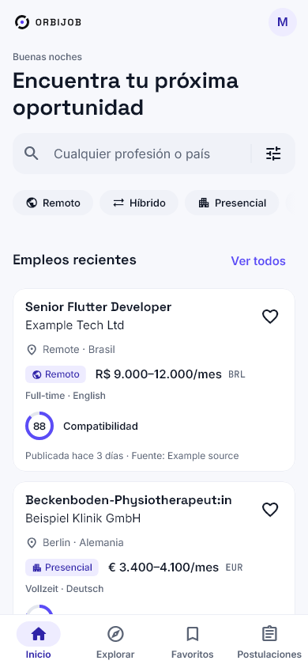
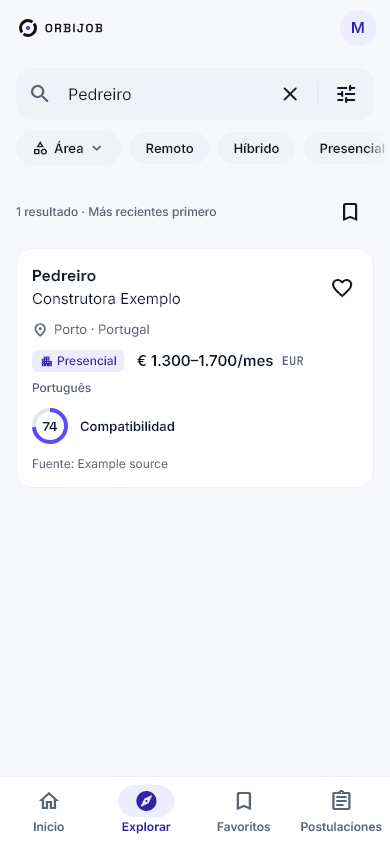
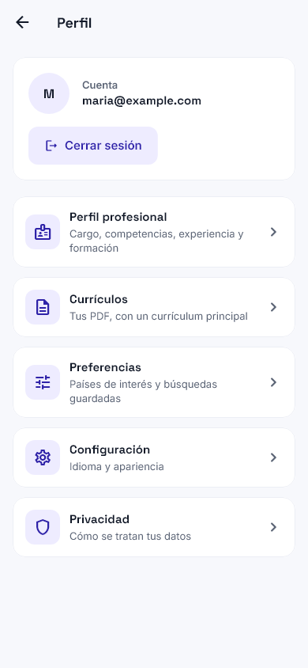

<p align="center"></p>

<h1 align="center">OrbiJob</h1>

<p align="center">Encuentra oportunidades en todo el mundo. Mantén tu carrera organizada.</p>

<p align="center">      </p>

<p align="center"><a href="README.md">English</a> · <a href="README.pt-BR.md">Português</a> · <b>Español</b></p>

---

OrbiJob reúne la búsqueda internacional de empleo y el seguimiento personal de las postulaciones. Cubre **todas las profesiones**, presenciales, híbridas y remotas. La ingeniería Flutter/mobile y la fisioterapia (incluida la de suelo pélvico) reciben investigación extra de fuentes, pero la plataforma no se limita a ellas.

**Web:** [orbijob.lucksrei.com](https://orbijob.lucksrei.com) · **Caso:** [lucksrei.com/projects/orbijob](https://lucksrei.com/projects/orbijob/)

## Índice

- [Funciones](#funciones)
- [Fuentes de empleo](#fuentes-de-empleo)
- [Capturas](#capturas)
- [Arquitectura](#arquitectura)
- [Ejecutar en local](#ejecutar-en-local)
- [Limitaciones](#limitaciones)
- [Estado](#estado)
- [Documentación](#documentación)

## Funciones

**Encontrar empleo**
- Búsqueda por título, profesión, especialidad, país, continente, área, modalidad, fecha y salario.
- **Profesiones multilingües:** una profesión escrita en un idioma también se encuentra escrita en portugués, inglés, español, alemán, sueco, neerlandés, francés o checo (ESCO, © Unión Europea, CC BY 4.0), sin convertir una profesión calificada en todo su campo ("ingeniero civil" no es "cualquier ingeniero"). Un resultado vacío sugiere una profesión más amplia o de escritura parecida.
- Detalle de la oferta con la descripción original, ubicación, modalidad, atribución de la fuente y enlace al anuncio.
- **Traducción automática** de títulos y descripciones al idioma de la app, en el propio dispositivo, con el original a un toque ([docs/TRANSLATION.md](docs/TRANSLATION.md)).
- **Lectura sin conexión:** las búsquedas, favoritos y postulaciones ya vistos abren sin conexión, con su fecha, y se actualizan solos cuando vuelve la conexión ([docs/OFFLINE.md](docs/OFFLINE.md)).

**Recomendaciones y alertas**
- **Recomendaciones explicables:** un ranking determinista a partir de tus profesiones, especialidad, lugares, idiomas y modalidad, con los motivos y advertencias de cada oferta. Distingue la misma profesión, el mismo grupo ocupacional, una profesión relacionada y solo la misma área (ESCO/ISCO); un área sola nunca recomienda una oferta, y no se afirma nada sobre visados ni colegiaturas.
- **Búsquedas guardadas** con alertas por búsqueda (cada hora, diaria o semanal): las ofertas nuevas llegan a un centro de notificaciones en la app, nunca dos veces. En Android también llegan como push.
- Ocultar ofertas (con deshacer y lista para restaurar) y búsquedas recientes guardadas solo en el dispositivo.

**Tu carrera**
- Perfil con experiencia, formación, habilidades, idiomas y preferencias.
- **Currículums:** subida privada de PDF, extracción local del texto y revisión editable antes de guardar nada en el perfil.
- **Embudo de postulaciones:** etapas de interesado a contratado o rechazado, notas, fechas de entrevista y seguimiento con recordatorios y agenda. Una postulación solo se marca como enviada cuando lo confirmas.
- **Kit de postulación:** copia datos verificados del perfil y el currículum principal. OrbiJob **nunca** envía postulaciones por ti.
- Compara hasta tres ofertas lado a lado y comparte el enlace de una oferta, usando solo lo que dicen los anuncios.

**Cuenta y privacidad**
- Inicio de sesión por e-mail, restablecimiento de contraseña con código de 6 dígitos, exportación de datos (ZIP) y eliminación de la cuenta dentro de la app.
- Inglés, portugués de Brasil y español; temas claro, oscuro y del sistema; diseños para móvil, tablet y escritorio.

## Fuentes de empleo

Solo se guardan las fuentes cuyos términos, leídos en el texto original, permiten mostrar las ofertas con atribución y enlace de vuelta. **Hay 19 fuentes publicadas**, con unas 26 000 ofertas visibles (las cifras cambian cada día).

| Región | Fuentes |
| --- | --- |
| Remoto / global | Jobicy, Remote OK, Remotive |
| Europa | Arbeitnow (Alemania/UE), Karriere.NRW (Alemania), Platsbanken/JobTech (Suecia), Teaching Vacancies (Inglaterra), Groupe BPCE y Choisir le Service Public (Francia), Le Forem (Bélgica), Úřad práce ČR (Chequia), SEF Murcia, Feina Activa/SOC, ECYL y Lanbide (España) |
| Américas | NYC Jobs (EE. UU.), Get on Board (Latinoamérica) |
| Asia-Pacífico | Taiwan Jobs Open Data, Jobs.co.nz (Nueva Zelanda) |

La licencia de cada fuente aparece en la página de licencias de la app. Evidencias, fuentes rechazadas y fuentes que esperan al dueño (City of Calgary, SINE-ES, USAJOBS, NAV): [matriz de fuentes](docs/SOURCES_MATRIX.md), [6.0](docs/SOURCES_6_0.md), [12.0](docs/SOURCES_12_0.md), [13.0](docs/SOURCES_13_0.md), [14.0](docs/SOURCES_14_0.md) y [Brasil](docs/ORBIJOB_14_1_BRAZIL.md).

## Capturas

### Buscar y descubrir

<table><tr><td align="center"><br><sub><b>Inicio</b></sub></td><td align="center"><br><sub><b>Explorar</b></sub></td><td align="center"><br><sub><b>Filtros</b></sub></td><td align="center"><br><sub><b>Detalle de la oferta</b></sub></td></tr></table>

### Tu carrera, en un solo lugar

<table><tr><td align="center"><br><sub><b>Perfil</b></sub></td><td align="center"><br><sub><b>Currículums</b></sub></td><td align="center"><br><sub><b>Revisión del PDF</b></sub></td><td align="center"><br><sub><b>Kit de postulación</b></sub></td></tr></table>

### Alertas, recomendaciones y seguimiento

<table><tr><td align="center"><br><sub><b>Recomendaciones</b></sub></td><td align="center"><br><sub><b>Búsquedas guardadas</b></sub></td><td align="center"><br><sub><b>Notificaciones</b></sub></td><td align="center"><br><sub><b>Postulaciones</b></sub></td><td align="center"><br><sub><b>Comparar</b></sub></td></tr></table>

### Traducción automática (Android)

<table><tr><td align="center"><br><sub><b>Oferta en sueco</b></sub></td><td align="center"><br><sub><b>Chino tradicional</b></sub></td></tr></table>

Más capturas: [galería 2.0](docs/design/orbijob-v2/README.md) (claro, oscuro, tablet, escritorio, PT y ES) y [galería 3.0](docs/design/orbijob-v3/README.md) (en/pt/es, móvil y escritorio). Usan datos de prueba controlados y no representan el inventario real de ofertas.

## Arquitectura

```text
Flutter (Android / iOS / Web)
  ├─ Búsqueda pública, detalle y filtros de ofertas
  └─ Supabase Auth → perfil, currículums, favoritos y postulaciones
          │
          └─ PostgreSQL + RLS + Storage privado

Fuentes de empleo → conectores TypeScript → catálogo validado
                                      ├─ descubrimiento incremental
                                      ├─ revalidación y vigencia (72 h)
                                      └─ retención, deduplicación y protección de datos personales

GitHub Actions + tareas programadas en Supabase
```

Las ofertas conservan la atribución y el enlace original. No encontrar resultados no significa que no haya ofertas en ese país o profesión. El proyecto prioriza infraestructura gratuita e integraciones responsables. [Arquitectura](docs/ARCHITECTURE.md) · [Política de vigencia](docs/FRESHNESS_POLICY.md) · [Seguridad](docs/SECURITY.md).

| Área | Tecnología |
|---|---|
| App | Flutter / Dart, Clean Architecture por feature, Cubit/BLoC, GetIt |
| Diseño e idiomas | design system de OrbiJob, claro/oscuro, Flutter ARB (EN / PT-BR / ES) |
| Backend | Supabase Auth, PostgreSQL, Row Level Security, Storage, Edge Functions, tareas SQL programadas |
| Ingesta | conectores TypeScript, programaciones en GitHub Actions (descubrimiento, revalidación, watchdog, salud) |
| Web | Cloudflare Workers Static Assets |
| Calidad | pruebas Flutter de widgets/accesibilidad, pruebas TypeScript, pruebas SQL en PostgreSQL 16/17, gitleaks, CI en GitHub Actions |

## Ejecutar en local

Requisitos: **Flutter 3.47.7**, Node.js y la configuración pública de Supabase del proyecto. Nunca versiones tokens ni credenciales service-role.

```bash
cd app
cp dart_defines.example.json dart_defines.dev.json   # solo valores seguros para el cliente
flutter pub get
flutter gen-l10n
flutter analyze
flutter test
flutter run --dart-define-from-file=dart_defines.dev.json
```

Consulta [configuración de Supabase](docs/SUPABASE_SETUP.md), [deploy Web](docs/WEB_DEPLOY.md) y [ejecución Web en Windows](docs/WINDOWS_WEB_RUN.md).

Worker y conectores:

```bash
cd worker
npm ci
npm run typecheck
npm test
```

### Repositorio

```text
app/        app Flutter y pruebas de widgets
worker/     conectores TypeScript, ingesta y pruebas
supabase/   migrations, políticas, Edge Functions y pruebas SQL
scripts/    scripts operativos y de validación
data/       metadatos de fuentes y profesiones
docs/       arquitectura, fuentes, seguridad, UX y capturas
.github/    CI y tareas programadas
```

## Limitaciones

- La cobertura varía según el país, el sector, los términos de la fuente y la fecha de publicación.
- Las ofertas vienen de terceros: confirma los requisitos y la elegibilidad con el empleador.
- La lectura de currículums funciona en PDF con texto; los PDF escaneados o protegidos no se leen (sin OCR), y los campos extraídos siempre requieren revisión.
- La traducción se ejecuta en el dispositivo; iOS y el traductor del navegador aún no se han validado.
- Push solo en Android; el push en iPhone y en el navegador no está activado.

## Estado

El código Flutter cubre Android, iOS y Web. La **app Web está en línea**. El primer build de iOS pasó por App Review y fue rechazado el 23/10/2026 por la directriz 5.1.1(v) (eliminación de cuenta difícil de encontrar); la corrección ya está en `main` y falta enviar un nuevo build. Todavía no está en Google Play. Qué está listo, parcial o pendiente, área por área: [checklist general](docs/ORBIJOB_MASTER_CHECKLIST.md).

## Documentación

Los documentos están mayormente en inglés.

- [Checklist general](docs/ORBIJOB_MASTER_CHECKLIST.md): estado de todo el producto
- [Arquitectura](docs/ARCHITECTURE.md) y [arquitectura desplegada](docs/DEPLOYED_ARCHITECTURE.md)
- [Seguridad y privacidad](docs/SECURITY.md)
- [Profesiones y búsqueda multilingüe](docs/OCCUPATIONS.md)
- [Roadmap](docs/ROADMAP.md)
- Notas por versión: [3.0](docs/ORBIJOB_3_0.md), [5.0](docs/ORBIJOB_5_0.md), [8.0](docs/ORBIJOB_8_0.md), [9.0/10.0](docs/ORBIJOB_9_10.md), [11.0](docs/ORBIJOB_11_0.md), [14.0](docs/ORBIJOB_14_0_PROGRESS.md)

## Privacidad y licencias

Los datos privados y los archivos de currículum están protegidos por reglas de acceso por cuenta. Cada fuente de empleo tiene sus propias obligaciones de licencia y atribución ([matriz de fuentes](docs/SOURCES_MATRIX.md)). [Política de privacidad](https://lucksrei.com/projects/orbijob/privacy/) · [eliminación de datos](https://lucksrei.com/projects/orbijob/data-deletion/). No se concede ninguna licencia open source para este repositorio; todos los derechos reservados.

---

Creado por Lucas Diogo França, un producto de [Lucksrei](https://lucksrei.com).
