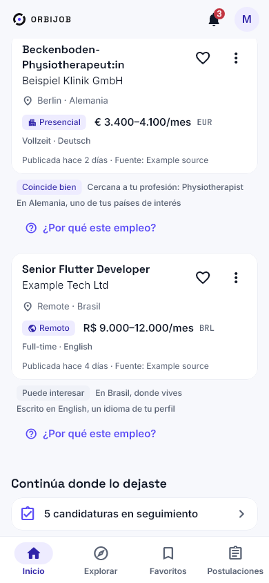
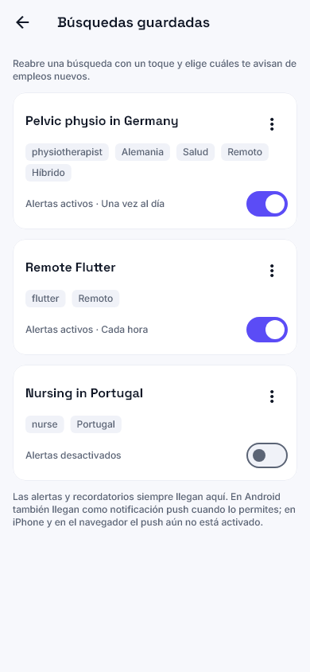
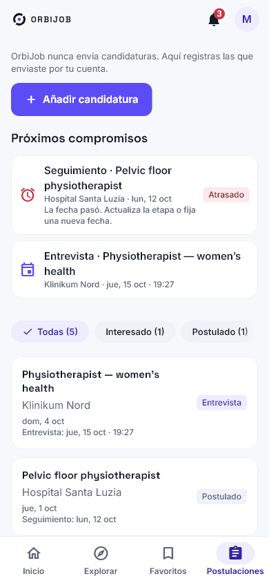

<p align="center"></p>

<h1 align="center">OrbiJob</h1>

<p align="center">Encuentra oportunidades en todo el mundo. Organiza tu carrera.</p>

<p align="center">     </p>

<p align="center"><a href="README.md">English</a> · <a href="README.pt-BR.md">Português</a> · <b>Español</b></p>

---

OrbiJob reúne la búsqueda internacional de empleo y el seguimiento de candidaturas en un solo lugar. Abarca **todas las profesiones**, con puestos presenciales, híbridos y remotos. Flutter/desarrollo móvil y fisioterapia — incluida la salud pélvica — reciben una investigación adicional de fuentes, pero la plataforma no está limitada a esos sectores.

## Funciones

- **Búsqueda global:** encuentra puestos por título, profesión, especialidad, país, continente y modalidad de trabajo.
- **Fuentes reales:** Jobicy, Arbeitnow, Remote OK, Remotive, Platsbanken/JobTech (Suecia), Taiwan Jobs Open Data y Jobs.co.nz. La disponibilidad cambia constantemente; consulta la [matriz de fuentes](docs/SOURCES_MATRIX.md).
- **Información transparente:** título, empresa, descripción original, ubicación, modalidad, atribución y señales de compatibilidad y confianza cuando haya datos suficientes.
- **Espacio profesional:** perfil, experiencia, formación, habilidades, idiomas, preferencias, favoritos y seguimiento de candidaturas.
- **Currículums PDF:** carga privada, currículum principal, sustitución, eliminación, extracción local de texto y revisión editable antes de aplicar sugerencias al perfil.
- **Kit de candidatura:** copiar datos del perfil, acceder al currículum y registrar una candidatura con confirmación. OrbiJob no envía candidaturas automáticamente.
- **Experiencia internacional:** inglés, portugués brasileño y español; temas claro/oscuro/sistema; diseño adaptable y animación de carga orbital.
- **Búsquedas guardadas y alertas (3.0):** guarda cualquier combinación de filtros, renómbrala, edítala, duplícala o elimínala, y activa alertas por búsqueda (cada hora, diaria o semanal). Las vacantes nuevas compatibles, abiertas y verificadas recientemente llegan a un centro de notificaciones en la app, nunca dos veces por la misma vacante. En Android también llegan como notificación push; en iPhone y en el navegador el push aún no está activo.
- **Recomendaciones explicables (3.0):** ranking determinista según tus profesiones, especialidad, lugares, idiomas y modalidad, para cualquier profesión, con los motivos y advertencias de cada vacante; no se afirma nada sobre visados o colegiaciones.
- **Ocultar vacantes y búsquedas recientes (3.0):** oculta una vacante con deshacer y lista para restaurar; las búsquedas recientes quedan en el dispositivo, por cuenta, y se pueden desactivar o borrar.
- **Embudo de candidaturas (3.0):** etapas de interesado a contratado o rechazado, notas personales, fechas de entrevista y seguimiento con recordatorios en el centro de notificaciones (y push en Android) y una agenda; una candidatura solo se marca como enviada cuando lo confirmas.
- **Compartir y comparar (3.0):** comparte el enlace de una vacante y compara vacantes lado a lado (tabla en pantallas anchas, bloques en el móvil) solo con lo que dicen los anuncios, incluidas las habilidades que indica la fuente.

## Capturas de pantalla

### Buscar y descubrir

<table><tr><td align="center"><br><sub><b>Home</b></sub></td><td align="center"><br><sub><b>Explore</b></sub></td><td align="center"><br><sub><b>Filters</b></sub></td><td align="center"><br><sub><b>Job details</b></sub></td></tr></table>

### Tu carrera, en un solo lugar

<table><tr><td align="center"><br><sub><b>Profile</b></sub></td><td align="center"><br><sub><b>Résumés</b></sub></td><td align="center"><br><sub><b>PDF review</b></sub></td><td align="center"><br><sub><b>Application kit</b></sub></td></tr></table>

### Alertas, recomendaciones y seguimiento (3.0)

<table><tr><td align="center"><br><sub><b>Recomendaciones</b></sub></td><td align="center"><br><sub><b>Búsquedas guardadas</b></sub></td><td align="center"><br><sub><b>Notificaciones</b></sub></td><td align="center"><br><sub><b>Candidaturas</b></sub></td><td align="center"><br><sub><b>Comparar</b></sub></td></tr></table>

Más capturas de 3.0 (en/pt/es, claro/oscuro, móvil/escritorio): [galería 3.0](docs/design/orbijob-v3/README.md).

Más capturas reales de widgets Flutter (tema claro y oscuro, escritorio, tableta, PT y ES) están en la [galería](docs/design/orbijob-v2/README.md). Utilizan datos de prueba controlados y no representan el inventario real.

## Arquitectura

```text
Flutter (Android / iOS / Web)
  ├─ Búsqueda pública, detalles y filtros de empleo
  └─ Supabase Auth → perfil, currículums, favoritos y candidaturas
          │
          └─ PostgreSQL + RLS + Storage privado

Fuentes de empleo → Conectores TypeScript → Catálogo validado
                                        ├─ Descubrimiento incremental
                                        ├─ Revalidación y vigencia
                                        └─ Retención, duplicados y supervisión

GitHub Actions + tareas programadas en Supabase
```

Los anuncios conservan su fuente y URL originales. La cobertura depende de la licencia de cada proveedor y de la vigencia de los datos; una búsqueda sin resultados no demuestra que no haya empleos en ese sector o país. Se prioriza la infraestructura gratuita. [Arquitectura](docs/ARCHITECTURE.md) · [Fuentes](docs/SOURCES_MATRIX.md) · [Actualización](docs/FRESHNESS_POLICY.md) · [Seguridad](docs/SECURITY.md).

## Tecnologías

| Área | Tecnología |
|---|---|
| Aplicación | Flutter / Dart, Clean Architecture por funcionalidad, Cubit/BLoC, GetIt |
| Diseño e idiomas | OrbiJob 2.0, temas claro/oscuro, Flutter ARB — ES / EN / PT-BR |
| Backend | Supabase Auth, PostgreSQL, RLS, Storage, tareas SQL programadas |
| Ingesta | TypeScript / componentes Cloudflare Worker, conectores, GitHub Actions |
| Calidad | Tests Flutter de widgets/accesibilidad, TypeScript, PostgreSQL 16/17, GitHub Actions CI |

## Ejecutar localmente

Requisitos: Flutter compatible (la aplicación exige Dart `^3.13.5`), Node.js y configuración pública de Supabase. Nunca incluyas credenciales privadas en Git.

```bash
cd app
flutter pub get
flutter gen-l10n
flutter analyze
flutter test
flutter run -d chrome --dart-define-from-file=dart_defines.web.json
```

En móvil, utiliza el archivo de configuración local ignorado `dart_defines.dev.json`. Consulta [Supabase setup](docs/SUPABASE_SETUP.md) y [ejecución en Windows](docs/WINDOWS_WEB_RUN.md). El comando Web supone que el archivo local ya existe y contiene únicamente valores públicos para el cliente.

```bash
cd worker
npm ci
npm run typecheck
npm test
```

## Estructura del repositorio

```text
app/        Aplicación Flutter y tests
worker/     Componentes TypeScript de API/ingesta y tests
supabase/   Migraciones, políticas y tests SQL
scripts/    Scripts operativos y de validación
data/       Metadatos de fuentes y ocupaciones
docs/       Arquitectura, fuentes, seguridad, UX y capturas
.github/    CI y tareas automáticas
```

## Limitaciones importantes

- La cobertura varía según el país, profesión, condiciones de cada fuente y actualidad de los anuncios. Los totales cambian continuamente.
- Los anuncios proceden de terceros: verifica requisitos y elegibilidad con el empleador.
- La lectura local de currículums funciona con PDF que contienen texto. Los documentos escaneados o protegidos pueden no leerse; las sugerencias siempre requieren revisión.
- El Kit de candidatura permite preparar y registrar candidaturas; OrbiJob **no presenta solicitudes ni rellena formularios de terceros automáticamente**.
- En móvil, algunos anuncios pueden abrirse en un navegador interno con opción de abrir externamente. Ciertos portales restringen su navegación o autenticación incrustada.
- La traducción automática de anuncios está en desarrollo y no está garantizada para todas las plataformas e idiomas.

## Plataformas y estado

El código Flutter admite Android, iOS y Web. Se han ejecutado tests automatizados, un build APK debug Android y un build Web release; **no se afirma que se haya validado completamente en dispositivos físicos ni que esté publicado en las tiendas**. Consulta [estado de OrbiJob 2.0](docs/ORBIJOB_2_0_STATUS.md) , [progreso](docs/ORBIJOB_2_0_PROGRESS.md) y [guía de 3.0](docs/ORBIJOB_3_0.md). Se añadirán enlaces a las tiendas tras su publicación.

## Privacidad y licencias

Los datos privados y los archivos de currículum tienen controles de acceso por cuenta. No deben versionarse secretos. Cada fuente de empleo conserva sus propias licencias y obligaciones de atribución: consulta la [matriz](docs/SOURCES_MATRIX.md). Este repositorio no declara una licencia general de código abierto; todos los derechos reservados.

## Créditos

Un producto de **Lucksrei** · [lucksrei.com](https://lucksrei.com) · Lucas Diogo França.
