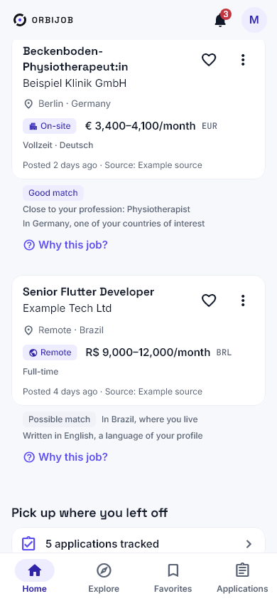
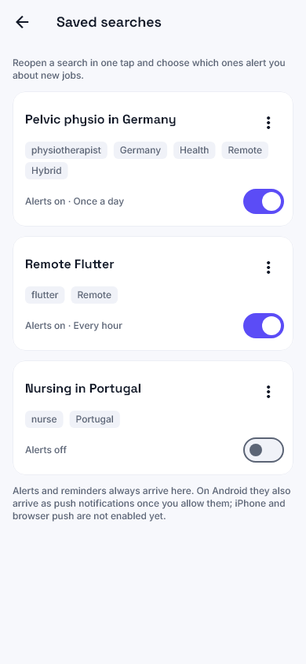
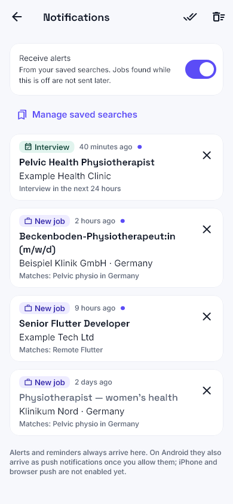
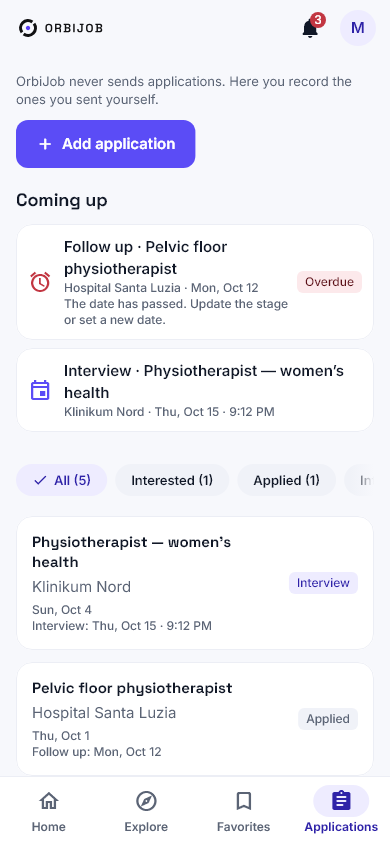

<p align="center"></p>

<h1 align="center">OrbiJob</h1>

<p align="center">Find opportunities worldwide. Keep your career organized.</p>

<p align="center">      </p>

<p align="center"><b>English</b> · <a href="README.pt-BR.md">Português</a> · <a href="README.es.md">Español</a></p>

---

OrbiJob brings international job discovery and personal application tracking together. It covers **every profession**, in person, hybrid and remote. Flutter/mobile engineering and physiotherapy (including pelvic health) get extra source research, but the platform is not limited to them.

**Web:** [orbijob.lucksrei.com](https://orbijob.lucksrei.com) · **Case study:** [lucksrei.com/projects/orbijob](https://lucksrei.com/projects/orbijob/)

## Contents

- [Features](#features)
- [Job sources](#job-sources)
- [Screenshots](#screenshots)
- [Architecture](#architecture)
- [Run locally](#run-locally)
- [Limits](#limits)
- [Status](#status)
- [Documentation](#documentation)

## Features

**Find jobs**
- Search by title, profession, specialty, country, continent, area, work mode, date and salary.
- **Multilingual professions:** a profession typed in one language also finds it written in Portuguese, English, Spanish, German, Swedish, Dutch, French or Czech (ESCO, © European Union, CC BY 4.0), without widening a qualified profession into its whole field ("civil engineer" is not "any engineer"). An empty result suggests a broader or similarly spelled profession.
- Job details with the original description, location, work mode, source attribution and a link back to the listing.
- **Automatic translation** of titles and descriptions into the app language, on the device, with the original one tap away ([docs/TRANSLATION.md](docs/TRANSLATION.md)).
- **Offline reading:** searches, favorites and applications already seen reopen without a connection, dated, and refresh by themselves when it returns ([docs/OFFLINE.md](docs/OFFLINE.md)).

**Recommendations and alerts**
- **Explainable recommendations:** a deterministic ranking from your professions, specialty, places, languages and work mode, with the reasons and caveats for every job. It tells apart the same profession, the same occupation group, a related profession and only the same area (ESCO/ISCO); an area alone never recommends a job, and nothing is claimed about visas or licences.
- **Saved searches** with alerts per search (hourly, daily or weekly): new matching jobs arrive in an in-app notification center, never twice. On Android they also arrive as push notifications.
- Hide jobs (with undo and a restore list) and device-only recent searches.

**Your career**
- Profile with experience, education, skills, languages and preferences.
- **Résumés:** private PDF upload, local text extraction and an editable review before anything is saved to the profile.
- **Application pipeline:** stages from interested to hired or rejected, notes, interview and follow-up dates with reminders and an agenda. An application is marked as sent only when you confirm it.
- **Application kit:** copy verified profile details and the primary résumé. OrbiJob **never** submits applications for you.
- Compare up to three jobs side by side and share a job link, using only what the listings state.

**Account and privacy**
- Email sign-in, password reset with a 6-digit code, data export (ZIP) and in-app account deletion.
- English, Brazilian Portuguese and Spanish; light, dark and system themes; phone, tablet and desktop layouts.

## Job sources

Only sources whose terms, read in the primary text, allow showing the listings with attribution and a link back are stored. **19 sources are published**, with about 26,000 visible listings (counts change every day).

| Region | Sources |
| --- | --- |
| Remote / global | Jobicy, Remote OK, Remotive |
| Europe | Arbeitnow (Germany/EU), Karriere.NRW (Germany), Platsbanken/JobTech (Sweden), Teaching Vacancies (England), Groupe BPCE and Choisir le Service Public (France), Le Forem (Belgium), Úřad práce ČR (Czechia), SEF Murcia, Feina Activa/SOC, ECYL and Lanbide (Spain) |
| Americas | NYC Jobs (USA), Get on Board (Latin America) |
| Asia-Pacific | Taiwan Jobs Open Data, Jobs.co.nz (New Zealand) |

Each source's licence is listed on the app's licence page. Evidence, rejected sources and sources waiting on the owner (City of Calgary, SINE-ES, USAJOBS, NAV): [source matrix](docs/SOURCES_MATRIX.md), [6.0](docs/SOURCES_6_0.md), [12.0](docs/SOURCES_12_0.md), [13.0](docs/SOURCES_13_0.md), [14.0](docs/SOURCES_14_0.md) and [Brazil](docs/ORBIJOB_14_1_BRAZIL.md).

## Screenshots

### Search and discover

<table><tr><td align="center"><br><sub><b>Home</b></sub></td><td align="center"><br><sub><b>Explore</b></sub></td><td align="center"><br><sub><b>Filters</b></sub></td><td align="center"><br><sub><b>Job details</b></sub></td></tr></table>

### Your career, in one place

<table><tr><td align="center"><br><sub><b>Profile</b></sub></td><td align="center"><br><sub><b>Résumés</b></sub></td><td align="center"><br><sub><b>PDF review</b></sub></td><td align="center"><br><sub><b>Application kit</b></sub></td></tr></table>

### Alerts, recommendations and follow-up

<table><tr><td align="center"><br><sub><b>Recommendations</b></sub></td><td align="center"><br><sub><b>Saved searches</b></sub></td><td align="center"><br><sub><b>Notifications</b></sub></td><td align="center"><br><sub><b>Applications</b></sub></td><td align="center"><br><sub><b>Compare</b></sub></td></tr></table>

### Automatic translation (Android)

<table><tr><td align="center"><br><sub><b>Swedish listing</b></sub></td><td align="center"><br><sub><b>Traditional Chinese</b></sub></td></tr></table>

More captures: [2.0 gallery](docs/design/orbijob-v2/README.md) (light, dark, tablet, desktop, PT and ES) and [3.0 gallery](docs/design/orbijob-v3/README.md) (en/pt/es, phone and desktop). They use controlled test data and are not evidence of live job inventory.

## Architecture

```text
Flutter (Android / iOS / Web)
  ├─ Public job discovery, details and filters
  └─ Supabase Auth → private profiles, résumés, saved jobs, applications
          │
          └─ PostgreSQL + RLS + private Storage

Public job providers → TypeScript connectors → validated job catalogue
                                      ├─ incremental discovery
                                      ├─ revalidation / freshness (72 h)
                                      └─ retention, deduplication, personal-data guard

GitHub Actions + Supabase scheduled jobs
```

Source attribution and original URLs stay attached to listings. A missing result does not mean there are no jobs in that country or profession. The project favors free infrastructure and safe provider integration. [Architecture](docs/ARCHITECTURE.md) · [Freshness policy](docs/FRESHNESS_POLICY.md) · [Security](docs/SECURITY.md).

| Area | Technology |
|---|---|
| App | Flutter / Dart, feature-first Clean Architecture, Cubit/BLoC, GetIt |
| Design and l10n | OrbiJob design system, light/dark, Flutter ARB (EN / PT-BR / ES) |
| Backend | Supabase Auth, PostgreSQL, Row Level Security, Storage, Edge Functions, scheduled SQL jobs |
| Ingestion | TypeScript connectors, GitHub Actions schedules (discovery, revalidation, watchdog, health) |
| Web | Cloudflare Workers Static Assets |
| Quality | Flutter widget/accessibility tests, TypeScript tests, SQL tests on PostgreSQL 16/17, gitleaks, GitHub Actions CI |

## Run locally

Requirements: **Flutter 3.47.7**, Node.js and the project's public Supabase configuration. Never commit tokens or service-role credentials.

```bash
cd app
cp dart_defines.example.json dart_defines.dev.json   # client-safe values only
flutter pub get
flutter gen-l10n
flutter analyze
flutter test
flutter run --dart-define-from-file=dart_defines.dev.json
```

See [Supabase setup](docs/SUPABASE_SETUP.md), [Web deploy](docs/WEB_DEPLOY.md) and [Windows web run](docs/WINDOWS_WEB_RUN.md).

Worker and connectors:

```bash
cd worker
npm ci
npm run typecheck
npm test
```

### Repository

```text
app/        Flutter application and widget tests
worker/     TypeScript connectors, ingestion and tests
supabase/   migrations, policies, Edge Functions and SQL tests
scripts/    operational and validation scripts
data/       source and occupation metadata
docs/       architecture, sources, security, UX and screenshots
.github/    CI and scheduled jobs
```

## Limits

- Coverage varies by country, sector, provider terms and recency.
- Listings come from third parties; requirements and eligibility must be confirmed with the employer.
- Résumé reading works on text-based PDFs; scanned or encrypted PDFs are not read (no OCR), and extracted fields always need review.
- Translation runs on the device; iOS and the browser translator have not been validated yet.
- Push notifications work on Android only; iPhone and browser push are not enabled.

## Status

The Flutter codebase targets Android, iOS and Web. The **Web app is live**. The first iOS build went to App Review and was rejected on 2026-10-23 for guideline 5.1.1(v) (account deletion hard to find); the fix is in `main` and a new build is pending. Not on Google Play yet. What is done, partial or pending, area by area: [master checklist](docs/ORBIJOB_MASTER_CHECKLIST.md).

## Documentation

- [Master checklist](docs/ORBIJOB_MASTER_CHECKLIST.md): whole-product status
- [Architecture](docs/ARCHITECTURE.md) and [deployed architecture](docs/DEPLOYED_ARCHITECTURE.md)
- [Security and privacy](docs/SECURITY.md)
- [Occupations and multilingual search](docs/OCCUPATIONS.md)
- [Roadmap](docs/ROADMAP.md)
- Release notes per version: [3.0](docs/ORBIJOB_3_0.md), [5.0](docs/ORBIJOB_5_0.md), [8.0](docs/ORBIJOB_8_0.md), [9.0/10.0](docs/ORBIJOB_9_10.md), [11.0](docs/ORBIJOB_11_0.md), [14.0](docs/ORBIJOB_14_0_PROGRESS.md)

## Privacy and licensing

Private candidate data and résumé files are protected by account-scoped access rules. Public job feeds have their own licence and attribution duties ([source matrix](docs/SOURCES_MATRIX.md)). [Privacy policy](https://lucksrei.com/projects/orbijob/privacy/) · [data deletion](https://lucksrei.com/projects/orbijob/data-deletion/). No open-source license is granted for this repository; all rights reserved.

---

Built by Lucas Diogo França, a [Lucksrei](https://lucksrei.com) product.
