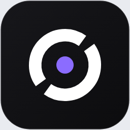
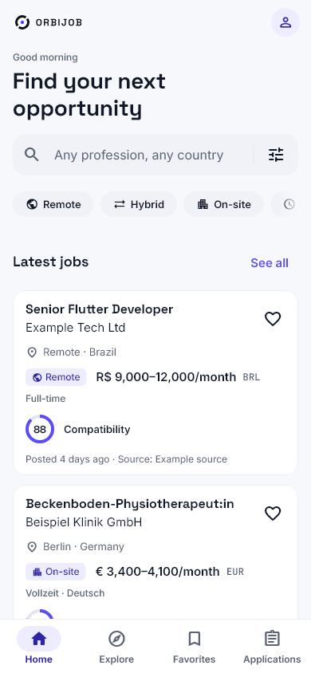
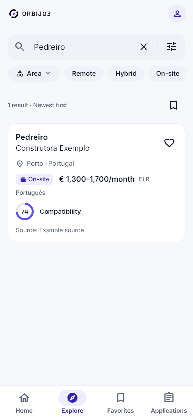
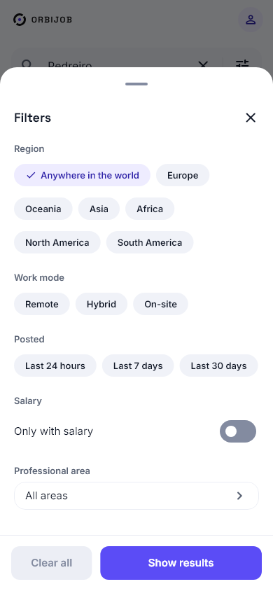
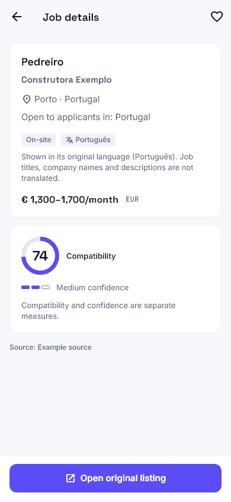
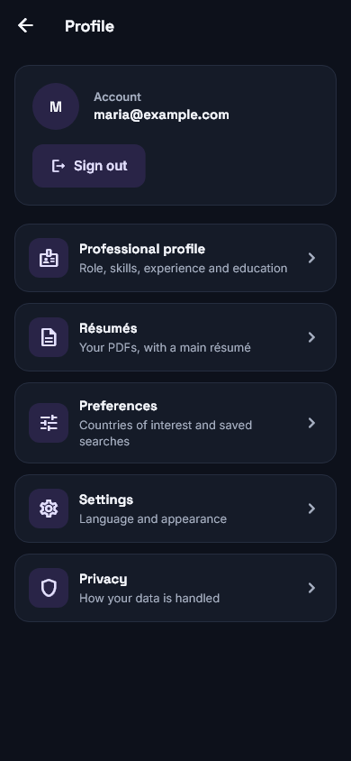
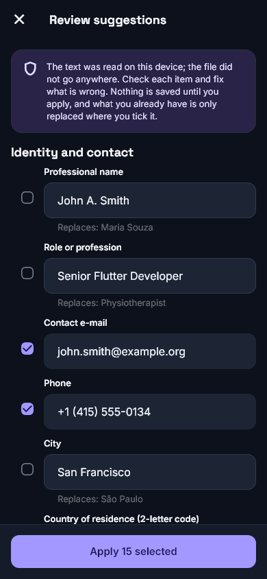
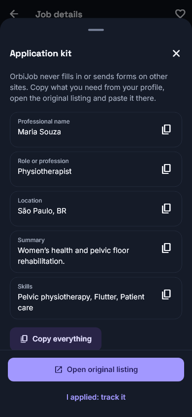
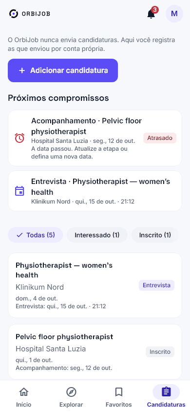
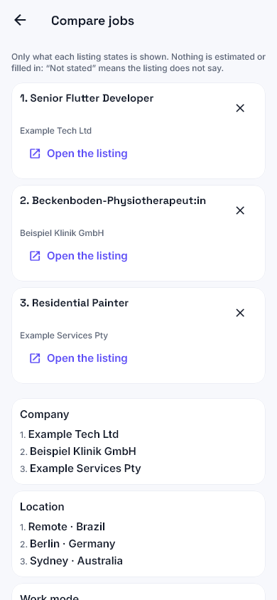

<p align="center"></p>

<h1 align="center">OrbiJob</h1>

<p align="center">Encontre oportunidades no mundo todo. Organize sua carreira.</p>

<p align="center">     </p>

<p align="center"><a href="README.md">English</a> · <b>Português</b> · <a href="README.es.md">Español</a></p>

---

O OrbiJob reúne a busca internacional de empregos e o acompanhamento de candidaturas em um só lugar. É voltado a **todas as profissões**, com oportunidades presenciais, híbridas e remotas. Flutter/desenvolvimento mobile e fisioterapia — inclusive pélvica — recebem pesquisa adicional de fontes, sem limitar o público do aplicativo.

## Funcionalidades

- **Busca mundial:** pesquise por cargo, profissão, especialidade, país, continente e modalidade de trabalho.
- **Fontes reais:** Jobicy, Arbeitnow, Remote OK, Remotive, Platsbanken/JobTech (Suécia), Taiwan Jobs Open Data e Jobs.co.nz. A disponibilidade muda continuamente; confira a [matriz de fontes](docs/SOURCES_MATRIX.md).
- **Detalhes transparentes:** cargo, empresa, descrição original, localização, modalidade, atribuição da fonte e indicadores de compatibilidade e confiança quando houver dados suficientes.
- **Carreira organizada:** perfil profissional, experiência, formação, habilidades, idiomas, preferências, favoritos e acompanhamento de candidaturas.
- **Currículos em PDF:** upload privado, currículo principal, substituição, exclusão, leitura local de texto e revisão editável antes de aplicar sugestões ao perfil.
- **Kit de candidatura:** copiar informações do perfil, acessar currículo e registrar candidatura mediante confirmação. O OrbiJob não envia candidaturas automaticamente.
- **Experiência internacional:** interface em português, inglês e espanhol; temas claro/escuro/sistema; layout responsivo e loading com a identidade orbital.
- **Pesquisas salvas e alertas (3.0):** salve qualquer combinação de filtros, renomeie, edite, duplique ou exclua, e ligue alertas por pesquisa (a cada hora, diário ou semanal). Vagas novas compatíveis, abertas e verificadas recentemente chegam a uma central de notificações no app, nunca duas vezes para a mesma vaga. No Android também chegam como notificação push; no iPhone e no navegador o push ainda não está ativo.
- **Recomendações explicáveis (3.0):** ranking determinístico a partir das suas profissões, especialidade, locais, idiomas e modalidade, para qualquer profissão, com os motivos e ressalvas de cada vaga; nada é afirmado sobre vistos ou registros profissionais.
- **Ocultar vagas e pesquisas recentes (3.0):** oculte uma vaga com desfazer e lista para restaurar; as pesquisas recentes ficam no aparelho, por conta, e podem ser desligadas ou apagadas.
- **Funil de candidaturas (3.0):** etapas de interessado a contratado ou rejeitado, notas pessoais, datas de entrevista e retorno com lembretes na central de notificações (e push no Android) e uma agenda; a candidatura só é marcada como enviada quando você confirma.
- **Compartilhar e comparar (3.0):** compartilhe o link de uma vaga e compare vagas lado a lado (tabela em telas largas, blocos no celular) só com o que os anúncios informam, inclusive as habilidades que a fonte lista.
- **Busca multilíngue por profissão (5.0):** uma profissão digitada em um idioma também encontra a mesma profissão escrita nos outros (pt, en, es, de, sv, nl, fr), a partir da tabela de ocupações ESCO (© União Europeia, CC BY 4.0), sem transformar uma profissão qualificada no campo inteiro ("engenheiro civil" não é "qualquer engenheiro", "fisioterapia pélvica" não é "qualquer fisioterapia"). Os alertas das pesquisas salvas usam exatamente a mesma regra do app, e um resultado vazio sugere uma profissão mais ampla ou de grafia parecida. Detalhes e antes/depois medido: [ORBIJOB_5_0.md](docs/ORBIJOB_5_0.md).

## Capturas de tela

### Busca e descoberta

<table><tr><td align="center"><br><sub><b>Home</b></sub></td><td align="center"><br><sub><b>Explore</b></sub></td><td align="center"><br><sub><b>Filters</b></sub></td><td align="center"><br><sub><b>Job details</b></sub></td></tr></table>

### Sua carreira em um só lugar

<table><tr><td align="center"><br><sub><b>Profile</b></sub></td><td align="center"><br><sub><b>Résumés</b></sub></td><td align="center"><br><sub><b>PDF review</b></sub></td><td align="center"><br><sub><b>Application kit</b></sub></td></tr></table>

### Alertas, recomendações e acompanhamento (3.0)

<table><tr><td align="center"><br><sub><b>Recomendações</b></sub></td><td align="center"><br><sub><b>Pesquisas salvas</b></sub></td><td align="center"><br><sub><b>Notificações</b></sub></td><td align="center"><br><sub><b>Candidaturas</b></sub></td><td align="center"><br><sub><b>Comparar</b></sub></td></tr></table>

Mais capturas do 3.0 (en/pt/es, claro/escuro, celular/desktop): [galeria 3.0](docs/design/orbijob-v3/README.md).

Mais capturas reais dos widgets Flutter (claro, escuro, desktop, tablet, PT e ES) estão na [galeria](docs/design/orbijob-v2/README.md). Usam dados controlados de teste, não comprovam a quantidade de vagas em produção.

## Arquitetura

```text
Flutter (Android / iOS / Web)
  ├─ Busca pública, detalhes e filtros de vagas
  └─ Supabase Auth → perfil, currículos, favoritos e candidaturas
          │
          └─ PostgreSQL + RLS + Storage privado

Fontes de vagas → Conectores TypeScript → Catálogo validado
                                      ├─ Descoberta incremental
                                      ├─ Revalidação e atualidade
                                      └─ Retenção, deduplicação e monitoramento

GitHub Actions + rotinas agendadas no Supabase
```

As vagas preservam atribuição e links originais. A disponibilidade depende das condições das fontes e da atualização dos dados; não encontrar resultados não significa que não existem vagas naquela profissão ou país. Priorizamos infraestrutura gratuita e integrações responsáveis. [Arquitetura](docs/ARCHITECTURE.md) · [Fontes](docs/SOURCES_MATRIX.md) · [Política de atualização](docs/FRESHNESS_POLICY.md) · [Segurança](docs/SECURITY.md).

## Tecnologias

| Área | Tecnologias |
|---|---|
| Aplicativo | Flutter / Dart, Clean Architecture por funcionalidade, Cubit/BLoC, GetIt |
| Design e idiomas | OrbiJob 2.0, temas claro/escuro, Flutter ARB — PT-BR / EN / ES |
| Backend | Supabase Auth, PostgreSQL, RLS, Storage, tarefas agendadas SQL |
| Coleta | TypeScript / componentes Cloudflare Worker, conectores, GitHub Actions |
| Qualidade | Testes Flutter de widgets/acessibilidade, TypeScript, PostgreSQL 16/17, GitHub Actions CI |

## Executar localmente

Requisitos: Flutter compatível (o app exige Dart `^3.13.5`), Node.js e configuração pública do Supabase. Nunca versione tokens ou credenciais de serviço.

```bash
cd app
flutter pub get
flutter gen-l10n
flutter analyze
flutter test
flutter run -d chrome --dart-define-from-file=dart_defines.web.json
```

Para mobile, use o arquivo local ignorado `dart_defines.dev.json` conforme a configuração do ambiente. Veja [Supabase setup](docs/SUPABASE_SETUP.md) e [execução no Windows](docs/WINDOWS_WEB_RUN.md). O comando Web pressupõe que o arquivo de configuração local já existe e contém apenas valores seguros para o cliente.

```bash
cd worker
npm ci
npm run typecheck
npm test
```

## Estrutura do repositório

```text
app/        Aplicativo Flutter e testes
worker/     Código TypeScript de APIs/coleta e testes
supabase/   Migrations, políticas e testes SQL
scripts/    Scripts operacionais e de validação
data/       Metadados de fontes e profissões
docs/       Arquitetura, fontes, segurança, UX e capturas
.github/    CI e rotinas automáticas
```

## Limitações importantes

- A cobertura varia por país, profissão, licença da fonte e data de publicação. A quantidade de vagas muda continuamente.
- Os anúncios vêm de terceiros: confirme requisitos e elegibilidade diretamente com o empregador.
- A leitura local de currículos funciona em PDFs com camada de texto. PDFs escaneados ou protegidos podem não ser lidos; toda extração exige revisão do usuário.
- O Kit de candidatura ajuda a preparar e acompanhar candidaturas; o OrbiJob **não envia candidaturas nem preenche formulários de terceiros automaticamente**.
- No mobile, anúncios podem ser abertos em navegador interno com opção de navegador externo. Alguns portais podem restringir navegação ou autenticação incorporada.
- A tradução automática dos anúncios está em desenvolvimento e não é garantida para todas as plataformas e idiomas.

## Plataformas e estado

O código Flutter atende Android, iOS e Web. Há testes automatizados, build de APK debug Android e build Web release; **não afirmamos validação completa em aparelhos físicos nem publicação nas lojas**. Consulte [estado do OrbiJob 2.0](docs/ORBIJOB_2_0_STATUS.md) , [progresso](docs/ORBIJOB_2_0_PROGRESS.md) e [guia do 3.0](docs/ORBIJOB_3_0.md). Links de Google Play e App Store serão adicionados quando publicados.

## Privacidade e licenciamento

Dados privados e arquivos de currículo são protegidos por políticas de acesso por conta. Credenciais não devem ser versionadas. Cada fonte de vagas possui licenças e exigências de atribuição próprias: veja a [matriz](docs/SOURCES_MATRIX.md). Não há licença open source geral no repositório; todos os direitos reservados.

## Créditos

Um produto **Lucksrei** · [lucksrei.com](https://lucksrei.com) · Lucas Diogo França.
