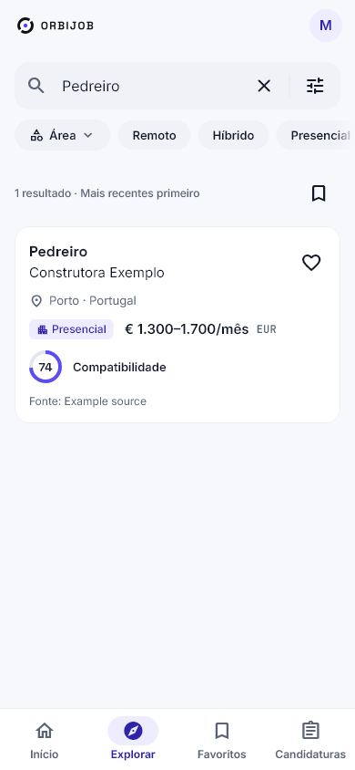
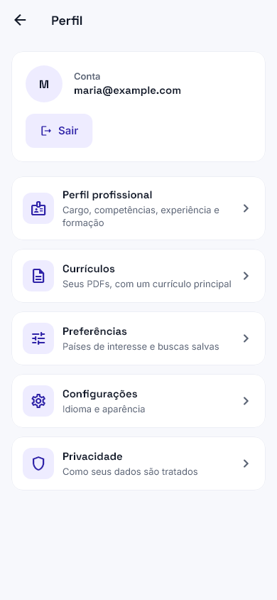
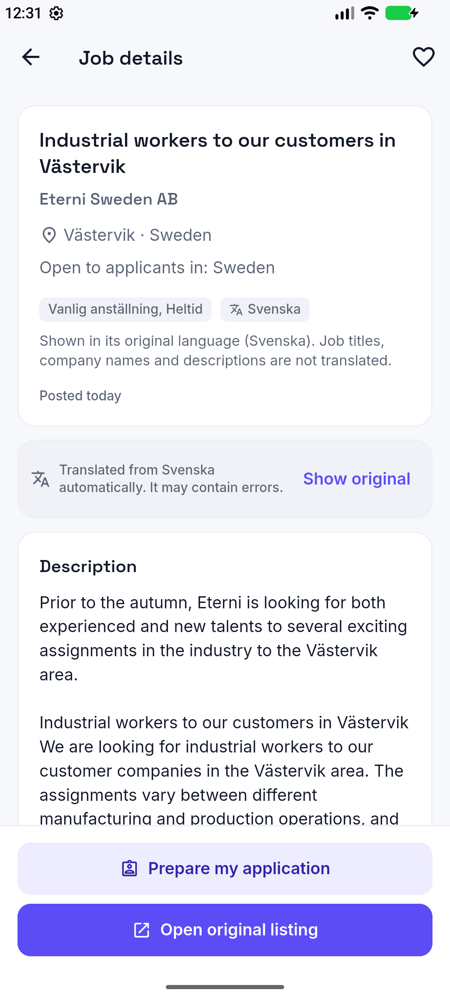
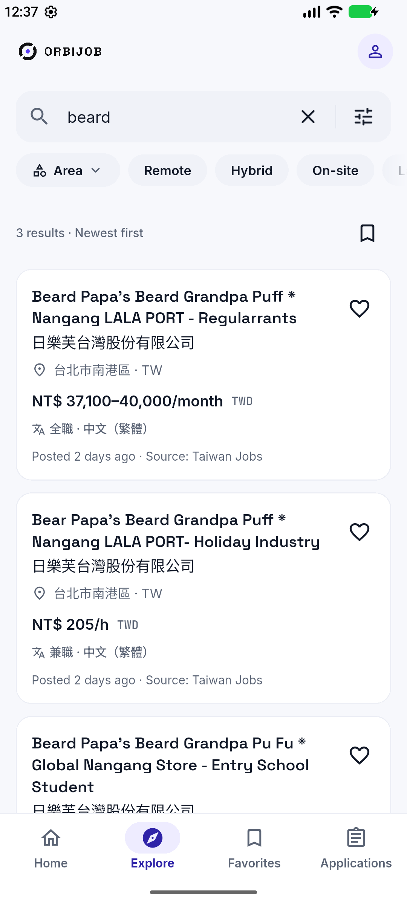

<p align="center"></p>

<h1 align="center">OrbiJob</h1>

<p align="center">Encontre oportunidades no mundo todo. Mantenha sua carreira organizada.</p>

<p align="center">      </p>

<p align="center"><a href="README.md">English</a> · <b>Português</b> · <a href="README.es.md">Español</a></p>

---

O OrbiJob junta a busca internacional de vagas e o acompanhamento pessoal das candidaturas. Atende **todas as profissões**, presenciais, híbridas e remotas. Engenharia Flutter/mobile e fisioterapia (inclusive pélvica) recebem pesquisa extra de fontes, mas a plataforma não se limita a elas.

**Web:** [orbijob.lucksrei.com](https://orbijob.lucksrei.com) · **Case:** [lucksrei.com/projects/orbijob](https://lucksrei.com/projects/orbijob/)

## Índice

- [Funcionalidades](#funcionalidades)
- [Fontes de vagas](#fontes-de-vagas)
- [Telas](#telas)
- [Arquitetura](#arquitetura)
- [Rodar localmente](#rodar-localmente)
- [Limitações](#limitações)
- [Estado](#estado)
- [Documentação](#documentação)

## Funcionalidades

**Encontrar vagas**
- Busca por título, profissão, especialidade, país, continente, área, modalidade, data e salário.
- **Profissões multilíngues:** uma profissão digitada num idioma também é encontrada escrita em português, inglês, espanhol, alemão, sueco, holandês, francês ou tcheco (ESCO, © União Europeia, CC BY 4.0), sem transformar uma profissão qualificada na área inteira ("engenheiro civil" não é "qualquer engenheiro"). Um resultado vazio sugere uma profissão mais ampla ou de grafia parecida.
- Detalhe da vaga com a descrição original, local, modalidade, atribuição da fonte e link para o anúncio.
- **Tradução automática** de títulos e descrições para o idioma do app, no próprio aparelho, com o original a um toque ([docs/TRANSLATION.md](docs/TRANSLATION.md)).
- **Leitura offline:** buscas, favoritos e candidaturas já vistos abrem sem conexão, com a data em que foram salvos, e se atualizam sozinhos quando a conexão volta ([docs/OFFLINE.md](docs/OFFLINE.md)).

**Recomendações e alertas**
- **Recomendações explicáveis:** ranking determinístico a partir das suas profissões, especialidade, locais, idiomas e modalidade, com os motivos e ressalvas de cada vaga. Distingue mesma profissão, mesmo grupo ocupacional, profissão relacionada e só a mesma área (ESCO/ISCO); a área sozinha nunca recomenda uma vaga, e nada é afirmado sobre vistos ou registros profissionais.
- **Pesquisas salvas** com alerta por pesquisa (a cada hora, diário ou semanal): vagas novas chegam numa central de notificações no app, nunca duas vezes. No Android também chegam como push.
- Ocultar vagas (com desfazer e lista para restaurar) e buscas recentes guardadas só no aparelho.

**Sua carreira**
- Perfil com experiência, formação, habilidades, idiomas e preferências.
- **Currículos:** upload privado de PDF, extração local do texto e revisão editável antes de salvar qualquer coisa no perfil.
- **Funil de candidaturas:** etapas de interessado a contratado ou recusado, anotações, datas de entrevista e retorno com lembretes e agenda. Uma candidatura só é marcada como enviada quando você confirma.
- **Kit de candidatura:** copie dados verificados do perfil e o currículo principal. O OrbiJob **nunca** envia candidaturas por você.
- Compare até três vagas lado a lado e compartilhe o link de uma vaga, usando só o que os anúncios informam.

**Conta e privacidade**
- Login por e-mail, redefinição de senha por código de 6 dígitos, exportação dos dados (ZIP) e exclusão da conta dentro do app.
- Inglês, português do Brasil e espanhol; temas claro, escuro e do sistema; layouts para celular, tablet e desktop.

## Fontes de vagas

Só entram no catálogo as fontes cujos termos, lidos no texto original, permitem exibir as vagas com atribuição e link de volta. **19 fontes estão publicadas**, com cerca de 26 mil vagas visíveis (os números mudam todo dia).

| Região | Fontes |
| --- | --- |
| Remoto / global | Jobicy, Remote OK, Remotive |
| Europa | Arbeitnow (Alemanha/UE), Karriere.NRW (Alemanha), Platsbanken/JobTech (Suécia), Teaching Vacancies (Inglaterra), Groupe BPCE e Choisir le Service Public (França), Le Forem (Bélgica), Úřad práce ČR (Tchéquia), SEF Murcia, Feina Activa/SOC, ECYL e Lanbide (Espanha) |
| Américas | NYC Jobs (EUA), Get on Board (América Latina) |
| Ásia-Pacífico | Taiwan Jobs Open Data, Jobs.co.nz (Nova Zelândia) |

A licença de cada fonte aparece na página de licenças do app. Evidências, fontes recusadas e fontes que aguardam o dono (City of Calgary, SINE-ES, USAJOBS, NAV): [matriz de fontes](docs/SOURCES_MATRIX.md), [6.0](docs/SOURCES_6_0.md), [12.0](docs/SOURCES_12_0.md), [13.0](docs/SOURCES_13_0.md), [14.0](docs/SOURCES_14_0.md) e [Brasil](docs/ORBIJOB_14_1_BRAZIL.md).

## Telas

### Busca e descoberta

<table><tr><td align="center"><br><sub><b>Início</b></sub></td><td align="center"><br><sub><b>Explorar</b></sub></td><td align="center"><br><sub><b>Filtros</b></sub></td><td align="center"><br><sub><b>Detalhe da vaga</b></sub></td></tr></table>

### Sua carreira em um só lugar

<table><tr><td align="center"><br><sub><b>Perfil</b></sub></td><td align="center"><br><sub><b>Currículos</b></sub></td><td align="center"><br><sub><b>Revisão do PDF</b></sub></td><td align="center"><br><sub><b>Kit de candidatura</b></sub></td></tr></table>

### Alertas, recomendações e acompanhamento

<table><tr><td align="center"><br><sub><b>Recomendações</b></sub></td><td align="center"><br><sub><b>Pesquisas salvas</b></sub></td><td align="center"><br><sub><b>Notificações</b></sub></td><td align="center"><br><sub><b>Candidaturas</b></sub></td><td align="center"><br><sub><b>Comparar</b></sub></td></tr></table>

### Tradução automática (Android)

<table><tr><td align="center"><br><sub><b>Vaga em sueco</b></sub></td><td align="center"><br><sub><b>Chinês tradicional</b></sub></td></tr></table>

Mais capturas: [galeria 2.0](docs/design/orbijob-v2/README.md) (claro, escuro, tablet, desktop, PT e ES) e [galeria 3.0](docs/design/orbijob-v3/README.md) (en/pt/es, celular e desktop). Usam dados de teste controlados e não comprovam a quantidade de vagas em produção.

## Arquitetura

```text
Flutter (Android / iOS / Web)
  ├─ Busca pública, detalhes e filtros de vagas
  └─ Supabase Auth → perfil, currículos, favoritos e candidaturas
          │
          └─ PostgreSQL + RLS + Storage privado

Fontes de vagas → conectores TypeScript → catálogo validado
                                      ├─ descoberta incremental
                                      ├─ revalidação e atualidade (72 h)
                                      └─ retenção, deduplicação e proteção de dados pessoais

GitHub Actions + rotinas agendadas no Supabase
```

As vagas mantêm a atribuição e o link original. Não encontrar resultado não significa que não existem vagas naquele país ou profissão. O projeto prioriza infraestrutura gratuita e integrações responsáveis. [Arquitetura](docs/ARCHITECTURE.md) · [Política de atualização](docs/FRESHNESS_POLICY.md) · [Segurança](docs/SECURITY.md).

| Área | Tecnologia |
|---|---|
| App | Flutter / Dart, Clean Architecture por feature, Cubit/BLoC, GetIt |
| Design e idiomas | design system OrbiJob, claro/escuro, Flutter ARB (EN / PT-BR / ES) |
| Backend | Supabase Auth, PostgreSQL, Row Level Security, Storage, Edge Functions, rotinas SQL agendadas |
| Coleta | conectores TypeScript, agendamentos no GitHub Actions (descoberta, revalidação, watchdog, saúde) |
| Web | Cloudflare Workers Static Assets |
| Qualidade | testes Flutter de widget/acessibilidade, testes TypeScript, testes SQL em PostgreSQL 16/17, gitleaks, CI no GitHub Actions |

## Rodar localmente

Requisitos: **Flutter 3.47.7**, Node.js e a configuração pública do Supabase do projeto. Nunca versione tokens nem credenciais service-role.

```bash
cd app
cp dart_defines.example.json dart_defines.dev.json   # só valores seguros para o cliente
flutter pub get
flutter gen-l10n
flutter analyze
flutter test
flutter run --dart-define-from-file=dart_defines.dev.json
```

Veja [configuração do Supabase](docs/SUPABASE_SETUP.md), [deploy Web](docs/WEB_DEPLOY.md) e [execução Web no Windows](docs/WINDOWS_WEB_RUN.md).

Worker e conectores:

```bash
cd worker
npm ci
npm run typecheck
npm test
```

### Repositório

```text
app/        app Flutter e testes de widget
worker/     conectores TypeScript, coleta e testes
supabase/   migrations, políticas, Edge Functions e testes SQL
scripts/    scripts operacionais e de validação
data/       metadados de fontes e profissões
docs/       arquitetura, fontes, segurança, UX e capturas
.github/    CI e rotinas agendadas
```

## Limitações

- A cobertura varia por país, setor, termos da fonte e data de publicação.
- Os anúncios vêm de terceiros: confirme requisitos e elegibilidade com o empregador.
- A leitura de currículos funciona em PDFs com texto; PDFs escaneados ou protegidos não são lidos (sem OCR), e os campos extraídos sempre precisam de revisão.
- A tradução roda no aparelho; iOS e o tradutor do navegador ainda não foram validados.
- Push só no Android; push no iPhone e no navegador não estão ativos.

## Estado

O código Flutter atende Android, iOS e Web. O **app Web está no ar**. O primeiro build iOS foi para a App Review e foi recusado em 23/10/2026 pela diretriz 5.1.1(v) (exclusão de conta difícil de achar); a correção já está na `main` e falta enviar um novo build. Ainda não está no Google Play. O que está pronto, parcial ou pendente, área por área: [checklist geral](docs/ORBIJOB_MASTER_CHECKLIST.md).

## Documentação

Os documentos estão majoritariamente em inglês.

- [Checklist geral](docs/ORBIJOB_MASTER_CHECKLIST.md): estado do produto inteiro
- [Arquitetura](docs/ARCHITECTURE.md) e [arquitetura publicada](docs/DEPLOYED_ARCHITECTURE.md)
- [Segurança e privacidade](docs/SECURITY.md)
- [Profissões e busca multilíngue](docs/OCCUPATIONS.md)
- [Roadmap](docs/ROADMAP.md)
- Notas por versão: [3.0](docs/ORBIJOB_3_0.md), [5.0](docs/ORBIJOB_5_0.md), [8.0](docs/ORBIJOB_8_0.md), [9.0/10.0](docs/ORBIJOB_9_10.md), [11.0](docs/ORBIJOB_11_0.md), [14.0](docs/ORBIJOB_14_0_PROGRESS.md)

## Privacidade e licenciamento

Dados privados e arquivos de currículo são protegidos por regras de acesso por conta. Cada fonte de vagas tem as próprias exigências de licença e atribuição ([matriz de fontes](docs/SOURCES_MATRIX.md)). [Política de privacidade](https://lucksrei.com/projects/orbijob/privacy/) · [exclusão de dados](https://lucksrei.com/projects/orbijob/data-deletion/). Nenhuma licença open source é concedida para este repositório; todos os direitos reservados.

---

Criado por Lucas Diogo França, um produto [Lucksrei](https://lucksrei.com).
